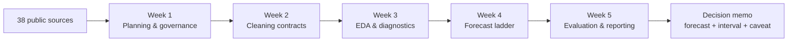

# Agribusiness Market Intelligence

### Junior Data Scientist Internship · Nagpur, India · 22 October – 26 November 2026

**Five weeks. Five reports. One auditable forecasting system.**

This repository is the complete work product of a five-week data science internship in agribusiness
market intelligence. It covers the full analytical chain — scoping, data contracts, exploratory
design, predictive modelling, evaluation and executive communication — and it carries the evidence
to support every claim.

**Status:** Weeks 1–4 submitted · Week 5 complete (ready to submit)

**Start here:** [Week 5 evaluation report](week5/Agribusiness_Model_Evaluation_Reporting_Strategy_Week5.docx) ·
[Executed audit](week5/README.md) · [What the evidence says](#what-the-evidence-says)

---

## Internship at a glance

| Field | Detail |
|---|---|
| **Role** | Junior Data Scientist Intern |
| **Location** | Nagpur, India |
| **Duration** | 22 October – 26 November 2026 (five weeks) |
| **Domain** | Agribusiness market intelligence |
| **Scope** | Six crops × eight Indian states; monthly wholesale prices and annual yields |
| **Cadence** | One applied research report per week, each with a dated review gate |
| **Output** | Five Word reports (182 pages), one executed notebook, reproducible code and data |
| **Status** | Weeks 1–4 submitted · Week 5 complete (ready to submit) |

The brief was not to build a single model and stop. It was to build a **data-driven agribusiness
intelligence capability**, one layer at a time:

1. **Plan** the analysis and define what evidence would count.
2. **Clean** the data with documented, reproducible contracts.
3. **Explore** the panel with a designed EDA architecture.
4. **Model** prices and yields with a leakage-safe ladder.
5. **Evaluate** the result and decide what it may legitimately be used for.

The final week answers the question a model cannot answer for itself: *what is this forecast allowed
to influence, and what evidence would change that answer?*

---

## The problem

Agribusiness decisions — procurement timing, storage, hedging, buffer-stock release, warehouse
allocation — depend on price and yield expectations. Generic machine learning fails in this setting
for five structural reasons:

- **Temporal leakage:** future information enters the training window through revisions, vintages or
  overlapping targets.
- **Inflation drift:** nominal prices create correlations that disappear once the price level is
  controlled.
- **Non-linear biophysical thresholds:** heat, rainfall and pest damage do not act in straight lines.
- **Mixed-frequency, mixed-lag dynamics:** weather, policy, arrivals and prices move on different clocks.
- **Policy regime shifts:** export bans, procurement floors and buffer norms break historical
  relationships.

This project treats those as **design requirements**, not footnotes. The result is a forecasting
system that reports a range, a benchmark, a failure register and a recommendation — not just a point
estimate.

---

## What was delivered

| Week | Internship brief → delivered | Evidence | Report |
|---|---|---|---|
| **1** | Analysis plan → 38-source inventory, 30 indicators, six-rung model ladder, nine-phase execution plan, pilot on real prices | 37 pages | [DOCX](week1/Agribusiness_Data_Analysis_Plan_Week1.docx) · [PDF](week1/Agribusiness_Data_Analysis_Plan_Week1_preview.pdf) |
| **2** | Cleaning strategy → 18-rule register (`R01`–`R18`), ten-step plan (`S0`–`S9`), seeded reference panel, audit log and reproducibility controls | 42 pages, 53 tables; usable price cells **92.3% → 98.5%** | [DOCX](week2/Agribusiness_Data_Cleaning_Preprocessing_Strategy_Week2.docx) · [PDF](week2/Agribusiness_Data_Cleaning_Preprocessing_Strategy_Week2_preview.pdf) |
| **3** | EDA design → 42 metrics across five lenses, five analytical typologies, visual encoding tree, anomaly triage protocol | 31 pages, 10 tables, 3 diagrams | [DOCX](week3/Agribusiness_EDA_Report_Design_Week3.docx) · [PDF](week3/Agribusiness_EDA_Report_Design_Week3_preview.pdf) |
| **4** | Modelling framework → six-rung ladder, 118 engineered predictors, anti-leakage rolling origin, executed notebook on real World Bank prices | 24 pages, 16 tables, 3 figures; 35-cell notebook, **0 errors** | [DOCX](week4/Agribusiness_Predictive_Modelling_Framework_Week4.docx) · [PDF](week4/Agribusiness_Predictive_Modelling_Framework_Week4_preview.pdf) · [Notebook](week4/notebooks/Agribusiness_Predictive_Modelling_Pipeline.ipynb) · [Data](week4/data/README.md) |
| **5** | Evaluation and reporting → metric hierarchy, 60-fold audit, bootstrap and Diebold–Mariano tests, conformal calibration, decision curves, executive reporting system | 48 pages, 40 tables, 12 figures; DOCX 1.05 MB; **1,440 forecasts, 0 model failures** | [DOCX](week5/Agribusiness_Model_Evaluation_Reporting_Strategy_Week5.docx) · [PDF](week5/Agribusiness_Model_Evaluation_Reporting_Strategy_Week5_preview.pdf) · [Audit](week5/README.md) |

### By the numbers

- **182 pages** across five Word reports.
- **54,900+ words** and **119+ tables** in Weeks 2–5 alone.
- **1,440** fold-level forecasts from **60** rolling origins, **4** horizons and **6** models.
- **322 months** of real World Bank price data, January 2000 to October 2026.

---

## How the system fits together



Each layer is a standalone Word report and a reproducible build. Each one is also a **contract for
the next**: the cleaning rules become the EDA input, the EDA design becomes the feature and diagnostic
specification, the modelling framework fixes the evaluation protocol, and the evaluation report
decides what survives.

### The five layers

| Layer | Question it answers | Main artefact |
|---|---|---|
| **Planning** | What are we forecasting, from which sources, and what would count as success? | 38-source inventory, indicator framework, gates and timeline |
| **Cleaning** | How do we make the panel usable without hiding defects? | 18-rule register, audit log, reproducibility controls |
| **Exploration** | What does the data actually look like, and which diagnostics are credible? | 42-metric architecture, typologies, visual standards, anomaly protocol |
| **Modelling** | Which model earns the right to be reported? | L0–L5 ladder, anti-leakage folds, feature engineering, executed notebook |
| **Evaluation** | What may the forecast be used for, and what would change our mind? | Metric hierarchy, significance tests, calibration, decision value, reporting system |

---

## Scope: design versus executed evidence

The project deliberately separates the **Indian panel design** from the **real-data audit**. That
distinction is central to the work: a design target is a specification, not evidence.

| Dimension | Indian panel design (Weeks 1–3) | Executed evidence (Weeks 4–5) |
|---|---|---|
| **Geography** | Six crops × eight Indian states | Five global benchmark commodities: wheat, rice, maize, soybeans, cotton |
| **Time window** | 72 months (2021–2026) | 322 months (January 2000 – October 2026); 310 usable design months |
| **Price target** | Monthly modal wholesale price at 1, 3, 6 and 12 months | Wheat (US HRW) price at 1, 3, 6 and 12 months |
| **Yield target** | Annual yield per crop and state | Not executed in the price audit |
| **Sources** | 38 public sources | World Bank Pink Sheet |
| **Predictors** | 30 indicators; 118 engineered features in the design | 31 predictors |
| **Validation** | 25 expanding-window folds in the design | 60 expanding-window folds, three-month step |
| **Models** | L0–L5 six-rung ladder | Six models, 1,440 forecasts |
| **Status** | Blueprint plus a seeded reference panel for cleaning and EDA | Real-data audit with archived outputs |

The Indian panel is the production target. The global benchmark audit is the evidence that the
method works, fails and reports honestly on data that actually exists today.

---

## Modelling and evaluation

### Six-rung model ladder

| Rung | Model | Role |
|---|---|---|
| **L0** | Random walk | Adversarial baseline #1 |
| **L1** | Seasonal naïve | Adversarial baseline #2 |
| **L2** | ETS(M,A,M) | Seasonal exponential smoothing |
| **L3** | SARIMAX(1,1,1)(1,1,1)₁₂ | Structural exogenous regressors |
| **L4** | Gradient boosting | LightGBM in the design; `HistGradientBoostingRegressor` in the portable executed audit |
| **L5** | Ensemble | Past-only inverse-MSE weights in the audit; CRPS-optimal weights in the design |

The rule is deliberately adversarial: a model is not reported unless it earns its place against the
naïve benchmarks. Failures are retained in the scorecard.

### Promotion gate

A candidate must pass an integrity check and four evidence gates:

- **G0 — Integrity:** no leakage, no future data, reproducible folds.
- **G1 — Accuracy:** MASE against the random walk below 1.0 at the same horizon.
- **G2 — Significance:** the paired improvement must be distinguishable from no effect.
- **G3 — Calibration:** empirical interval coverage must be close to nominal.
- **G4 — Decision value:** the forecast must improve a stated decision, not just a score.

### Metric suite

Accuracy alone is not enough. The audit reports:

- **Point accuracy:** MAE, RMSE, sMAPE, MASE, R² and bias.
- **Distributional accuracy:** pinball loss, 50/80/90/95% coverage, interval width and Winkler score.
- **Direction:** directional accuracy against the origin price.
- **Decision value:** cost-weighted error with a 4:1 shortfall-to-excess penalty, plus regret across a
  threshold grid.
- **Stability:** results by horizon, crop, regime and volatility tercile.
- **Uncertainty:** paired bootstrap intervals, Diebold–Mariano tests, minimum detectable effect and a
  Bonferroni-adjusted threshold.

Intervals are **online conformal**: fold *k* uses only residuals from folds before *k*. No future
outcome enters the band, so coverage is a testable promise rather than a modelling assumption.

---

## What the evidence says

Executed on wheat (US HRW), 60 rolling origins, four horizons and six models. MAE is in USD/metric
tonne.

| Horizon | Best candidate | MAE | MASE vs RW | 90% coverage | Directional accuracy | Verdict |
|---:|---|---:|---:|---:|---:|---|
| **1 month** | **Ensemble** | 12.09 | **0.979** | 90.4% | 50.0% | Passes accuracy; parity with random walk |
| **3 months** | SARIMAX | 21.94 | 1.031 | 82.7% | 46.7% | **Fails the accuracy gate** |
| **6 months** | SARIMAX | 33.79 | **0.991** | 84.6% | 55.0% | Passes accuracy; parity with random walk |
| **12 months** | **Ensemble** | 50.57 | **0.945** | 78.8% | 55.0% | Passes accuracy; interval under-covers |

### No improvement is statistically separable from zero

| Horizon | Best candidate | ΔMAE vs RW | 95% interval | p-value |
|---:|---|---:|---|---:|
| 1 | Ensemble | −0.26 | [−1.30, +0.75] | 0.615 |
| 3 | SARIMAX | +0.66 | [−0.89, +2.15] | 0.401 |
| 6 | SARIMAX | −0.30 | [−2.62, +1.96] | 0.803 |
| 12 | Ensemble | −2.95 | [−6.86, +1.02] | 0.535 |

A negative ΔMAE means the candidate beats the random walk. Every interval includes zero. At h=1 the
minimum detectable effect is **11.8%** of the random-walk MAE, so the design cannot resolve a 2% edge.

### Read this correctly

- **The Week 4 accuracy gate passes at one, six and twelve months — and fails at three.** That is the
  honest scorecard; it is not a full promotion.
- **The one-month ensemble is 2.1% closer than the random walk, but not significantly so.** A 2%
  improvement is inside the noise this dataset can resolve.
- **Direction is not a usable signal.** Accuracy ranges from 46.7% to 55.0%, inside the binomial noise
  band around a coin flip.
- **The twelve-month interval under-covers.** It contains 78.8% of outcomes against a nominal 90%,
  despite an average width of 155 USD/MT.
- **The result does not transfer uniformly.** At h=3 the ladder clears the gate for maize, soybeans
  and cotton, but not for wheat or rice.
- **Decision value is modest and in-sample.** A buy-now threshold of +0.5% reduces regret to 1.59%,
  against 2.49% for always waiting, on an average price near 267 USD/MT.
- **The design target and the measured result are different.** Week 4 specified MASE 0.54 at h=1 and
  0.74 at h=12; the audit measures 0.979 and 0.945. The gap is reported, not hidden.

### The recommendation

> **Use the model as a planning range, not a trading signal.** Publish the random walk at three
> months. Use the model at one, six and twelve months for budget and procurement ranges. Recalibrate
> the twelve-month band before showing it to a decision-maker. Test the decision value in a shadow
> deployment before it touches a live procurement rule.

The latest October 2026 origin forecast is **306.46 USD/MT** at one month, **304.11** at three months,
**309.77** at six months and **321.38** at twelve months, with empirical conformal bands.

---

## What the internship demonstrates

- **Applied time-series forecasting:** ETS, SARIMAX, gradient boosting, ensembles and conformal
  prediction on real commodity prices.
- **Leakage-safe evaluation:** expanding-window rolling origins, vintage rules and a documented
  anti-leakage checklist.
- **Uncertainty quantification:** paired bootstrap intervals, Diebold–Mariano tests, minimum
  detectable effect and calibration diagnostics.
- **Data engineering:** 18 cleaning rules, audit logs, seeded reference panels and reproducible
  dataset construction.
- **Decision science:** cost-weighted error, regret curves and a promotion gate tied to use, not just
  accuracy.
- **Executive communication:** five structured reports, a visual system for non-specialists and a
  four-box executive summary.
- **Reproducible delivery:** every report is generated from code, with a fact base that keeps prose
  and computed numbers aligned.

---

## Repository map

| Path | Contents |
|---|---|
| `week1/` | 37-page analysis plan, 38-source inventory, 30 indicators, nine-phase execution plan and real-price pilot |
| `week2/` | 42-page cleaning strategy, 18-rule register, reference panel pipeline, audit log and scorecard |
| `week3/` | 31-page EDA design, 42-metric architecture, five typologies, analytical engine and three diagrams |
| `week4/` | 24-page modelling framework, six-rung ladder, executed 35-cell notebook and real World Bank data |
| `week5/` | 48-page evaluation strategy, 60-fold audit, 12 figures, fact base and submission text |
| `week*/_build/` | Reproducible pipelines: facts → figures → DOCX → PDF, plus metadata scrubbing |
| `requirements.txt` | Python dependencies for analysis, notebooks and document generation |

Each week folder contains the report and a rendered preview. Weeks 2–5 add their build pipelines and
the supporting evidence needed to reproduce the numbers.

---

## Reproduce the work

```powershell
git clone https://github.com/SamrudhSS/yuvaintern.git
cd yuvaintern
python -m venv .venv
.venv\Scripts\activate
pip install -r requirements.txt
```

### Week 4 — executed modelling notebook

```powershell
python week4\_build\export_real_data.py
python week4\_build\create_notebook.py
python week4\_build\execute_notebook.py
python week4\_build\verify_notebook.py
```

### Week 5 — audit, figures, report and PDF

```powershell
python week5\_build\evaluation_engine.py
python week5\_build\diagram_generator.py
python week5\_build\build_week5.py
powershell -ExecutionPolicy Bypass -File week5\_build\export_pdf.ps1
python week5\_build\scrub_metadata.py all
```

The full Week 5 audit takes roughly ten minutes because it fits ETS and SARIMAX at 60 origins. The
figure, document and PDF steps take under a minute. Microsoft Word is required for the automated PDF
export; the committed `facts.json` and CSV outputs mean the report can be rebuilt without rerunning
the full audit.

---

## Technical stack

| Layer | Tools |
|---|---|
| **Analysis** | Python 3.10+ (built on 3.14), pandas, NumPy |
| **Econometrics** | statsmodels (ETS, SARIMAX, STL, Diebold–Mariano), scikit-learn |
| **Visualisation** | matplotlib, Pillow |
| **Reporting** | python-docx, Microsoft Word COM automation, PyMuPDF |
| **Notebook** | Jupyter, nbformat, nbclient |
| **Environment** | Windows, PowerShell, Git |

---

## Limitations and next steps

| Limitation | Why it matters | Next step |
|---|---|---|
| **Global benchmark proxy** | The executed audit uses World Bank prices, not Indian mandi-level transactions | Ingest the Agmarknet/DES panel and rerun the same protocol |
| **Short history and regime shifts** | Long-horizon calibration is unstable across policy regimes | Add regime-weighted conformal intervals and a longer history |
| **No live deployment** | The decision-value result is in-sample | Run a twelve-month shadow deployment before production use |
| **Model parity** | No candidate is statistically better than the random walk | Pre-register a narrower hypothesis and test it on new data |
| **Design vs execution learner** | LightGBM is specified in the design; the portable audit uses HistGradientBoosting | Add a controlled LightGBM rerun and compare like for like |
| **Twelve-month calibration** | 78.8% coverage against a nominal 90% is not decision-grade | Recalibrate before any executive band is published |

The project is deliberately not presented as a deployed product. It is a validated research and
decision framework with a clear boundary around what the evidence supports.

---

## Project outcome

The internship produced more than a forecast. It produced a repeatable way to decide whether a
forecast deserves to be used: a benchmark, an interval, a significance test, a calibration check, a
decision curve, a limitation register and a recommendation.

That is the difference between a model that scores well and a model that can be trusted with a
decision.

---

**Prepared by:** [@SamrudhSS](https://github.com/SamrudhSS)  
**Repository:** [github.com/SamrudhSS/yuvaintern](https://github.com/SamrudhSS/yuvaintern)  
**Internship:** Junior Data Scientist Internship · Nagpur, India · 22 October – 26 November 2026

**Data attribution:** World Bank Commodity Markets Outlook (Pink Sheet), DES, FAOSTAT, USDA NASS,
Agmarknet, data.gov.in, IMD, NASA POWER, Copernicus, UN Comtrade and ITC Trade Map. All sources are
public; attribution is retained in each report. Analysis is decision support, not investment or
agronomic advice.